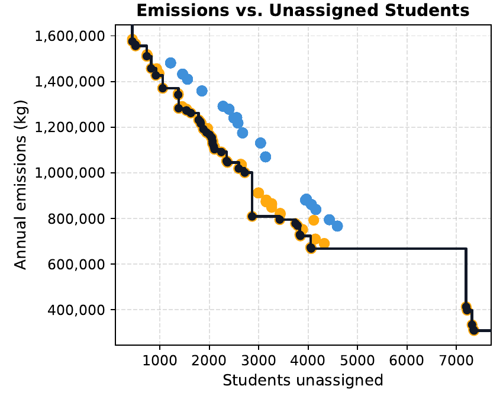
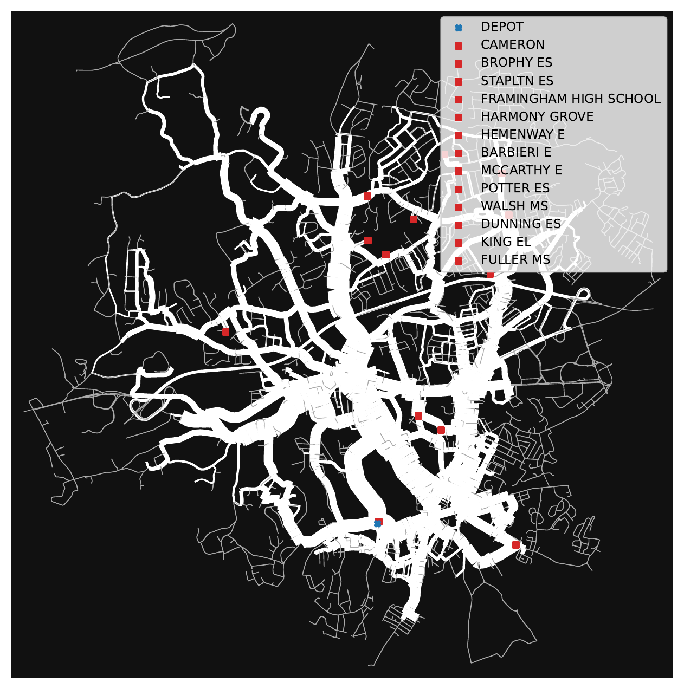

Cities and school districts face persistent challenges in designing bus systems that are efficient, reliable, and equitable under limited fleet, staffing, budget, and accessibility constraints. For my SuperUROP at MIT's Laboratory for Information and Decision Systems and Bachelor's thesis, I developed a co-design framework for bus network redesign using the monotone theory of co-design from applied category theory.

The framework represents routing service, fleet capacity, drivers, monitors, fuel, maintenance, policy requirements, and algorithmic choices as interconnected components, whose relationships can be compared through Pareto-front analysis. Rather than producing a single "best" routing plan, it shows the frontier between competing objectives.

_One of the thesis's Pareto fronts, comparing annual emissions and unassigned students across sampled routes and catalog configurations._

I demonstrated the framework through a case study of morning bus service in Framingham, MA. Under simplified travel-time assumptions, the routing approach serves the same 4,780 currently assigned riders with 48 buses rather than 51, and reduces estimated mean ride time from 43.08 to 30.52 minutes. The map shows the current routes, with the width of each road link varying based on how many buses travel along it.

_Framingham's current morning school bus routes. Wider lines mark roads that more buses travel along, and schools are in red._

These results are planning estimates rather than deployment-ready schedules, because they rely on constant-speed travel times and incomplete student-level linkage data. The current experiments also evaluate equity primarily after routing, so embedding it directly in the optimization is a direction for future work.
